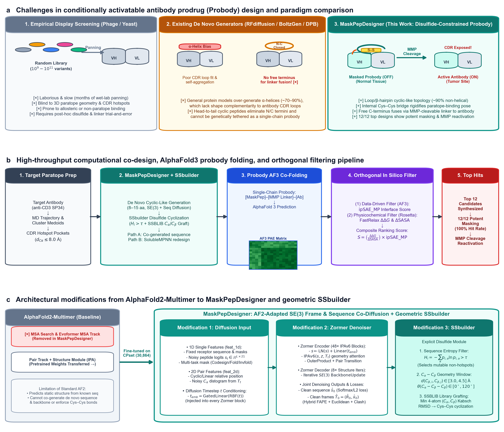

# MaskPepDesigner

[](LICENSE)
[](https://www.python.org/)
[](https://pytorch.org/)
[](MPDESIGNER_README.md)

This repository provides the official implementation of **MaskPepDesigner (MPD)**, an $SE(3)$-equivariant sequence–structure co-diffusion foundation model adapted from AlphaFold2-Multimer for the **de novo design of disulfide-constrained masking peptides, linear peptide binders, and head-to-tail macrocycles**, as well as **pocket-guided peptide docking (folding)** and **peptide inverse folding**.

> **MaskPepDesigner** is developed from Diffold and builds upon [DP Technology Uni-Fold](https://github.com/dptech-corp/Uni-Fold) and [AlphaFold2](https://github.com/deepmind/alphafold), with postprocessing modules adapted from [DiffPepBuilder](https://github.com/YuzheWangPKU/DiffPepBuilder). We thank the original authors for open-sourcing their work.



---

## Capabilities

**MaskPepDesigner** learns joint $SE(3)$ backbone frame ($\mathbb{R}^3$ translation + $\text{IGSO}(3)$ rotation) and amino acid sequence ($\mathbb{R}^{21}$ Gaussian logit) distributions conditioned on target receptor pockets. By simply adjusting the **contig prompt**, a single trained model supports a unified spectrum of peptide engineering tasks:

- **De Novo Peptide Co-Design (Sequence + Structure Generation)**:
  - **Disulfide-Constrained Cyclic Masking Peptides**: Generates loop- and $\beta$-hairpin-enriched cyclic-like peptides (`CPset`-trained) and couples with **SSbuilder** to automatically install strain-free Cys–Cys disulfide bridges at high-entropy positions while preserving free N/C termini for probody linker fusion.
  - **Linear & Head-to-Tail Macrocyclic Binders**: Supports both standard linear peptide generation and circular relative positional encoding (`cyclic` mode) for de novo head-to-tail macrocyclic binder design.
- **Peptide Folding / Hotspot-Guided Binding Pose Prediction (Flexible Peptide Docking)**:
  - When a peptide's **amino acid sequence is known**—and potential binding site residues (hotspots) on the target receptor are known or predicted by pocket-detection tools—fixing the peptide sequence (`@*`) while diffusing its 3D coordinates predicts the **bound 3D conformation and binding pose** directly within the target pocket.
- **Peptide Inverse Folding (Fixed-Backbone Sequence Design)**:
  - Given a fixed 3D protein–peptide complex backbone, masking only the peptide sequence (`@$`) designs optimal amino acid sequences tailored to the target receptor interface.
- **End-to-End All-Atom Refinement & Thermodynamic Scoring**:
  - Built-in parallel postprocessing pipeline combining **PDBFixer** sidechain reconstruction, restrained **OpenMM `Amber99sb`** energy minimization, and **PyRosetta `FastRelax` & `InterfaceAnalyzer`** ($\Delta\Delta G$ in R.E.U., `dG_cross/dSASAx100`, $\Delta\text{SASA}$, and full-ring macrocycle geometry auditing).

---

## Quickstart

### 1) Environment Setup

#### Option A: Unified Singularity / Apptainer Container (Recommended)
A pre-built container (`mpdesigner_diffpepbuilder.sif`) integrates `MaskPepDesigner`, `Uni-Core`, `PyTorch 2.2.0 (CUDA 11.8)`, `OpenMM 8.0`, `PDBFixer`, and `PyRosetta` in a single Conda environment (`/opt/miniconda3/envs/mpdesigner`), eliminating the need to switch environments between generation and postprocessing:

```bash
singularity exec --nv -B /lustre:/lustre -B /flashfs1:/flashfs1 \
    /path/to/mpdesigner_diffpepbuilder.sif \
    python run_MPDesigner.py -h
```

#### Option B: Conda & Pip Installation
Install the PyTorch / [Uni-Core](https://github.com/dptech-corp/Uni-Core) environment, then install `MaskPepDesigner` in editable mode from the repository root:

```bash
git clone -b mpd_dev https://github.com/Potter-Dai/MaskPepDesigner.git
cd MaskPepDesigner
pip install -e .
```

---

### 2) Contig Grammar & Multi-Task Configuration

Tasks are defined in a JSON file (`tasks.json`) mapping each task ID to a configuration dictionary. The `contig` string specifies the **receptor chain(s) first** and the **peptide chain second**, separated by a colon (`:`):

```text
<ReceptorChain><Start>-<End>{<HotspotResidues>}:@<Modifier><PeptideChain><Start>-<End>
```

#### Summary of Contig Modifiers

| Task Mode | Peptide Contig Syntax | Sequence | 3D Structure | Typical Use Case |
| :--- | :--- | :---: | :---: | :--- |
| **1. Pure De Novo Co-Design** (by length) | `A1-174{120-124,148}:@8-15` | **Generated** | **Generated** | Design novel peptides of length 8–15 aa targeting receptor hotspots `{120-124,148}` (no reference peptide needed in PDB) |
| **2. De Novo Co-Design** (reference length) | `A1-174{120-124,148}:@%B19-26` | **Generated** | **Generated** | Regenerate both sequence & 3D pose matching the length of reference chain `B19-26` |
| **3. Peptide Folding / Pose Prediction** | `A1-174{120-124,148}:@*B19-26` | **Fixed (`*`)** | **Generated** | **Flexible Peptide Docking**: Known peptide sequence (in chain `B`), predict its 3D binding pose at specified receptor hotspots |
| **4. Peptide Inverse Folding** | `A1-174{120-124,148}:@$B19-26` | **Generated** | **Fixed (`$`)** | **Sequence Redesign**: Known 3D peptide backbone pose (`B19-26`), design optimal binding sequences |
| **5. Fixed Motif Scaffolding** | `A1-174{120-124}:@3-5/B21-23/3-5` | **Partial** | **Partial** | Keep hot-spot anchor segment `B21-23` fixed and inpaint flanking N/C-terminal segments |

> **Notes on Input PDBs**:
> - You do **not** need to manually rename chains in your input PDB to `A` and `B`. Whatever receptor chain ID you specify before `:` (e.g., `H1-220{...}`) is automatically mapped to internal receptor chain `A`, and the peptide segment after `:` is mapped to internal peptide chain `B`.
> - If `{HotspotResidues}` is omitted when a reference peptide is present in the input PDB, `MaskPepDesigner` automatically extracts receptor residues within $8.0\text{ \AA}$ of the reference peptide $C_\alpha$ atoms as hotspots.

#### Example `tasks.json` Covering Co-Design, Folding (Docking), and Inverse Folding

```json
{
  "9f8e_denovo_codesign": {
    "pdb": "9f8e_complex",
    "contig": "A1-174{120-124,148,155,158-162}:@%B19-26",
    "initial_t": 1.0,
    "num_steps": 50,
    "num_replica": 100,
    "seed": 2026,
    "ignore_missing_residues": true,
    "save_trajectory": false
  },
  "9f8e_peptide_folding_docking": {
    "pdb": "9f8e_complex",
    "contig": "A1-174{120-124,148,155,158-162}:@*B19-26",
    "initial_t": 1.0,
    "num_steps": 50,
    "num_replica": 50,
    "seed": 2026,
    "ignore_missing_residues": true,
    "save_trajectory": false
  },
  "9f8e_inverse_folding": {
    "pdb": "9f8e_complex",
    "contig": "A1-174{120-124,148,155,158-162}:@$B19-26",
    "initial_t": 1.0,
    "num_steps": 50,
    "num_replica": 50,
    "seed": 2026,
    "ignore_missing_residues": true,
    "save_trajectory": false
  }
}
```

---

### 3) Run Inference & Postprocessing

#### 3.1 Standard Peptide Generation / Folding / Inverse Folding
```bash
python run_MPDesigner.py \
    --tasks /path/to/tasks.json \
    --input_pdbs /path/to/input_pdbs \
    --outputs /path/to/outputs \
    --checkpoint /path/to/checkpoint_last.pt \
    --model denovo \
    --device cuda:0
```
> **Output Coordinate Frame**: Generated complexes (`out_<task_id>_rep<NNN>_seed<SSSSS>.pdb`) are automatically translated back into the **exact world coordinate frame of the original input receptor PDB**, with fixed receptor sequences strictly preserved.

#### 3.2 Disulfide-Constrained Cyclic Peptide Generation (`SSbuilder`)
To automatically evaluate per-residue sequence Shannon entropy ($H_i > \tau$), screen $C_\alpha\text{–}C_\beta$ disulfide geometry, and graft full-atom Cys–Cys bridges from `SSBLIB`:
```bash
python run_MPDesigner_ss.py \
    --tasks /path/to/tasks.json \
    --input_pdbs /path/to/input_pdbs \
    --outputs /path/to/outputs_ss \
    --checkpoint /path/to/checkpoint_last.pt \
    --model denovo \
    --ss_build \
    --ss_entropy_threshold 0.5 \
    --ss_max_bonds 1 \
    --lig_chain B
```
**Outputs**:
- `out_<rep>.pdb`: Raw generated backbone complex (`Chain A` = cropped receptor, `Chain B` = peptide).
- `out_<rep>_CB.pdb`: Peptide structure with idealized virtual $C_\beta$ atoms.
- `out_<rep>_ss.pdb`: Disulfide-cyclized complex with grafted `CYS` sidechains ($C_\beta, S_\gamma$).

#### 3.3 All-Atom Refinement & Rosetta Interface Scoring (`DiffPepBuilder` Protocol)
Directly pass the generation output directory to `run_postprocess.py`. It automatically resolves the full native receptor via `task_config.json`, normalizes chain IDs (`Peptide -> Chain A`, `Receptor -> Chain B`) to match `analysis/interface_analyze.xml`, reconstructs sidechains with `PDBFixer`, minimizes with `OpenMM Amber99sb`, and runs `PyRosetta FastRelax` & `InterfaceAnalyzer`:

```bash
python run_postprocess.py \
    --in_pdbs /path/to/outputs/9f8e_denovo_codesign \
    --ori_pdbs /path/to/input_pdbs \
    --nproc 16 \
    --amber_relax \
    --rosetta_relax \
    --do_reconstruct \
    --lig_chain B
```
**Outputs**:
- `*_final.pdb`: Full-atom refined receptor–peptide complex.
- `postprocess_results.csv`: Summary table containing `ddg_norepack` (R.E.U.), `dG_cross/dSASAx100` (R.E.U./$\text{\AA}^2$), and `rmsd` ($\text{\AA}$).

#### 3.4 Head-to-Tail Macrocyclic Peptide Postprocessing
For head-to-tail macrocyclic designs (generated with `--model cyclic_denovo`), use the audited per-design adapter in `analysis/run_postprocess.py` (see [analysis/README.md](analysis/README.md) for full details):
```bash
python -m analysis.run_postprocess \
    --topology headtail --input-state backbone \
    --input-pdb generated_cyclic.pdb --original-pdb original_complex.pdb \
    --binder-chain B --receptor-chain A --output-dir results/headtail_001
```

---

## Training & Fine-Tuning

### Fine-Tuning on Peptide–Protein Complexes (`CPset`)
To fine-tune `MaskPepDesigner` from pretrained weights on a curated LMDB peptide–protein dataset:
```bash
bash finetune_MPDesigner_peptide.sh \
    /path/to/cpset_lmdb_dir \
    /path/to/save_dir \
    /path/to/pretrained_checkpoint.pt \
    denovo
```

### Pre-Training from Scratch / General Protein–Multimer Datasets
```bash
bash train_MPDesigner.sh \
    /path/to/unifold_db \
    /path/to/distillation_db \
    /path/to/esm_db \
    /path/to/save_dir \
    MPDesigner_v65
```

---

## Repository Structure

```text
MaskPepDesigner/
├── MPDesigner/                 # Core model, diffusion transitions, data pipeline & losses
│   ├── config_v6.py            # Model & diffusion hyperparameter configurations (v62–v66, denovo, cyclic)
│   ├── data/                   # LMDB loaders, spatial pocket cropping (data_ops.py) & featurization
│   ├── diffusion/              # R^3 translation, IGSO(3) rotation & Gaussian sequence diffusers
│   ├── nn/                     # MPDesigner (ZormerEncoderStack, ZormerDecoderStack, IPAv6, AuxHeads)
│   ├── losses/                 # Hybrid FAPE + Euclidean frame loss, sequence loss, clash & bond losses
│   └── inference/              # Contig parser, job manager, pocket centering & PDB writer
├── SSbuilder/                  # Explicit geometric disulfide builder & SSBLIB rotamer fragment library
├── analysis/                   # Linear, disulfide, and head-to-tail cyclic postprocessing & Rosetta XMLs
├── diffold/                    # Backward-compatibility import shims for legacy scripts/checkpoints
├── unifold/                    # Retained upstream Uni-Fold modules & stereo-chemical constants
├── tests/                      # Unit and regression test suite (run via `python -m unittest discover -s tests`)
├── run_MPDesigner.py           # Main inference entry point (co-design, folding/docking, inverse folding)
├── run_MPDesigner_ss.py        # Inference entry point with integrated SSbuilder disulfide cyclization
├── run_postprocess.py          # Parallel batch postprocessing entry point (PDBFixer + Amber + PyRosetta)
├── run_rescon_com.py           # Standalone SVD complex alignment & full-receptor reconstruction utility
└── finetune_MPDesigner_peptide.sh # Distributed multi-GPU fine-tuning launcher
```

### Additional Documentation
- [Input & Contig Reference (`MPDESIGNER_README.md`)](MPDESIGNER_README.md)
- [Linear & Head-to-Tail Cyclic Postprocessing Guide (`analysis/README.md`)](analysis/README.md)
- [Package Migration & Code Audit Notes (`docs/code_review_2026-09-07.md`)](docs/code_review_2026-09-07.md)

---

## License & Acknowledgments

This project is licensed under the **Apache License 2.0** (see [LICENSE](LICENSE)). Postprocessing utilities adapted from DiffPepBuilder retain their MIT License notice in [`analysis/DIFFPEPBUILDER_LICENSE.txt`](analysis/DIFFPEPBUILDER_LICENSE.txt).

Pull requests, bug reports, and scientific collaborations are warmly welcome!
